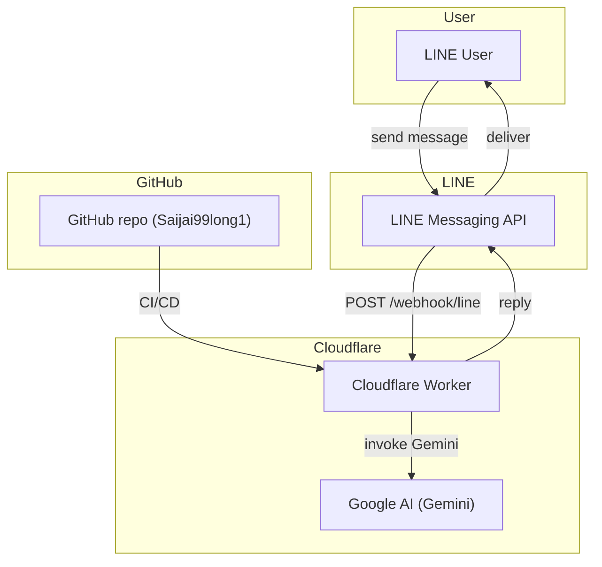

# Saijai 99 — LINE Webhook Worker

## Overview

This project implements a **Cloudflare Worker** that acts as a webhook endpoint for the **LINE Official Account**. It receives events from LINE, processes them (optionally using **Google AI (Gemini)** for smart response generation), and replies back to users. The repository is hosted on **GitHub** under the main branch `Saijai99long1` and uses **GitHub Actions** for CI/CD to automatically deploy the worker to Cloudflare environments (staging and production).



---

## Environments

- **Staging Worker**: `saijai99long1-staging`
- **Production Worker**: `saijai99long1-production` (configured separately; deployment gated by release approval)

---

## Prerequisites

| Tool | Version |
|------|---------|
| Node.js | 20+ |
| npm | latest |
| Cloudflare account | with Workers access |
| LINE Messaging API | channel secret & access token |
| Google Cloud project | Gemini API enabled |
| GitHub | repository `Saijai99long1` with write permissions |

---

## Setup

### 1. Clone the repository
```bash
git clone https://github.com/narathipkitchawan-ops/saijai99long1.git
cd saijai99long1
```

### 2. Install dependencies
```bash
npm install
```

### 3. Configure secrets

#### Cloudflare secrets (worker)
```bash
npx wrangler secret put LINE_CHANNEL_SECRET --env staging
npx wrangler secret put LINE_CHANNEL_ACCESS_TOKEN --env staging
```
> **Never** commit secrets. Use Cloudflare dashboard or `wrangler secret` for production as well.

#### GitHub Actions secrets (set in repo Settings → Secrets and variables → Actions)
- `CF_ACCOUNT_ID`
- `CF_API_TOKEN`
- `CF_ZONE_ID` (if using KV or R2)
- `LINE_CHANNEL_SECRET`
- `LINE_CHANNEL_ACCESS_TOKEN`
- `GEMINI_API_KEY`

### 4. Google AI (Gemini) integration
Create a **Google Cloud** project, enable the **Gemini API**, and obtain an API key. Store it as `GEMINI_API_KEY` in the GitHub Actions secrets and as a Cloudflare secret for the worker.

---

## Local Development

```bash
npm run dev   # Starts wrangler dev server with hot reload
```
The worker will be available at `http://127.0.0.1:8787/webhook/line`.

---

## CI/CD – GitHub Actions

The workflow file `.github/workflows/deploy.yml` builds the worker and deploys to Cloudflare on every push to the `main` branch.

```yaml
name: Deploy to Cloudflare
on:
  push:
    branches: [ main ]

jobs:
  build-and-deploy:
    runs-on: ubuntu-latest
    steps:
      - uses: actions/checkout@v4
      - name: Set up Node
        uses: actions/setup-node@v4
        with:
          node-version: '20'
      - run: npm ci
      - run: npm run build
      - name: Publish to Cloudflare (staging)
        env:
          CF_ACCOUNT_ID: ${{ secrets.CF_ACCOUNT_ID }}
          CF_API_TOKEN: ${{ secrets.CF_API_TOKEN }}
          LINE_CHANNEL_SECRET: ${{ secrets.LINE_CHANNEL_SECRET }}
          LINE_CHANNEL_ACCESS_TOKEN: ${{ secrets.LINE_CHANNEL_ACCESS_TOKEN }}
          GEMINI_API_KEY: ${{ secrets.GEMINI_API_KEY }}
        run: |
          npx wrangler publish --env staging
```
> For production deployment, create a separate workflow triggered by a `release` event and use the `production` environment.

---

## Deployment

### Staging
```bash
npm run deploy:staging
```
### Production
```bash
npm run deploy:production   # Only after release approval
```

---

## Endpoints

- `GET /health` – health check
- `POST /webhook/line` – validates the `x-line-signature` HMAC‑SHA256 header and processes the payload

---

## Testing

Unit tests are located in `tests/`. Run them with:
```bash
npm test
```

Integration tests can be executed against the dev server using the provided `scripts/test-integration.sh`.

---

## License

MIT © 2026 narathipkitchawan‑ops
